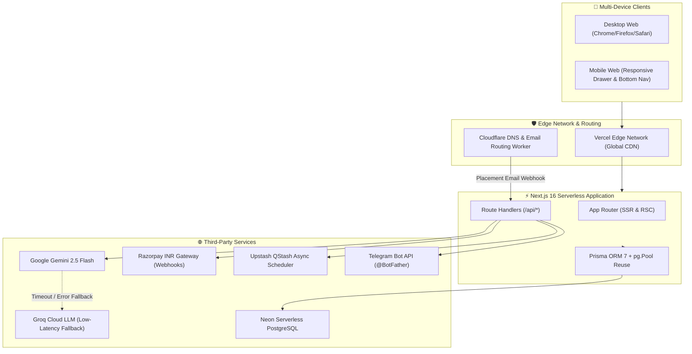

# 📚 ATSLift / ResumeForge — Technical Documentation Portal

Welcome to the central technical documentation portal for **ATSLift (ResumeForge)**. This repository houses a production-grade AI resume platform and autonomous campus placement engine engineered specifically for engineering students.

---

## 🧭 Documentation Directory

Explore the architectural, operational, and development documentation below:

| Document | Description | Target Audience |
| :--- | :--- | :--- |
| **[architecture.md](architecture.md)** | High-level system architecture, cloud topology, component boundaries, and technology stack breakdown. | System Architects, Tech Leads, Interviewers |
| **[system-design.md](system-design.md)** | Deep-dive into data models, parallel AI pipelines, state machines, async queues, and database lifecycle. | Senior Engineers, Backend Developers |
| **[benchmarks.md](benchmarks.md)** | Stress test reports, concurrency benchmarks, database wire payload reductions, and latency metrics. | DevOps, SREs, Performance Engineers |
| **[testing-strategy.md](testing-strategy.md)** | Test runner architecture, test suites (20 tests), HMAC cryptographic validation, and mock modes. | QA Engineers, Contributors |
| **[demo-guide.md](demo-guide.md)** | End-to-end walkthrough script for live demos, recruiter screens, and technical interviews. | Recruiters, Interviewers, Evaluators |
| **[api-reference.md](api-reference.md)** | OpenAPI-style specification for core endpoints, payloads, query parameters, and error status codes. | Frontend/Backend Developers, Integrators |
| **[security-and-compliance.md](security-and-compliance.md)** | HMAC webhook verification, sliding window rate limiting, daily quotas, and secret management. | Security Auditors, Compliance Teams |

---

## ⚡ High-Level System Overview



---

## 🛠️ Quick Reference & How to Run Locally

### Prerequisites
- **Node.js**: v20.x or higher
- **Database**: PostgreSQL (or free serverless Neon database connection string)
- **AI Engine**: Free Google Gemini API Key from Google AI Studio

### Step-by-Step Local Setup

```bash
# 1. Clone repository and install dependencies
git clone https://github.com/Nithin1138/ResumeForge.git
cd ResumeForge
npm install

# 2. Configure environment variables
cp .env.example .env
# Set DATABASE_URL and GEMINI_API_KEY in .env

# 3. Initialize database schema
npx prisma generate
npx prisma db push

# 4. Run test suite & start development server
npm test         # Executes all 20 unit & integration tests (runs in <200ms)
npm run dev      # Launches local dev server on http://localhost:3000
npm run build    # Generates production bundle with Turbopack

# 5. Query health check endpoint
curl http://localhost:3000/api/health
```

---

## 📖 Related Master Guides
- **Master Interview Architecture Deep-Dive:** [RESUME.md](../RESUME.md)
- **Top-Level Project Readme:** [README.md](../README.md)
- **Environment Configuration Reference:** [.env.example](../.env.example)
