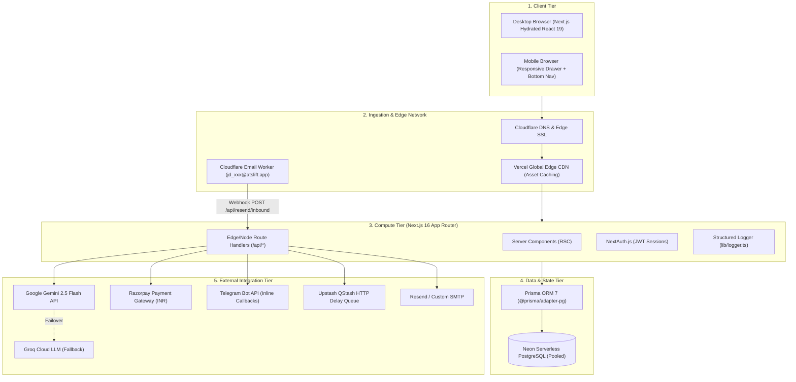
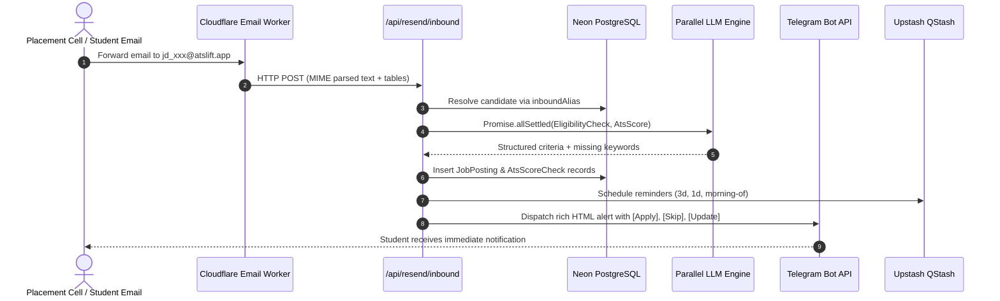

# 🏗️ System Architecture & Cloud Topology — ATSLift

## 1. Architectural Philosophy

ATSLift is architected as a **High-Performance Modular Monolith** built on **Next.js 16 (App Router)** and deployed to a globally distributed edge infrastructure. The application adheres to five core design principles:

1. **Edge-First Static Delivery**: Core application assets, pre-rendered marketing pages, and client bundles are served from global edge caches with immutable cache headers.
2. **Zero-Cold-Start Serverless Execution**: Serverless compute instances leverage connection pooling with global in-memory connection reuse (`globalForPrisma.pool`), preventing database connection exhaustion.
3. **Resilient Multi-Tier AI Failover**: Real-time LLM requests execute with timeout boundaries and cascade automatically from primary providers (Google Gemini 2.5 Flash) to secondary ultra-low-latency engines (Groq Cloud) and deterministic heuristic synthesizers.
4. **Asynchronous Non-Blocking Event Queuing**: Long-running background workflows—such as delayed campus drive application reminders—are offloaded to HTTP-based message queues (Upstash QStash) rather than blocking user-facing HTTP request cycles.
5. **Zero External Framework Bloat for Quality Engineering**: The automated test suite utilizes Node.js 20+ native test runner (`tsx --test`), avoiding heavy third-party runners like Jest or Vitest.

---

## 2. Multi-Tier Cloud Topology

---

## 3. Technology Stack Rationale

| Layer | Chosen Technology | Engineering Rationale | Alternative Considered |
| :--- | :--- | :--- | :--- |
| **Framework** | **Next.js 16.2 (App Router)** | Single unified codebase for React Server Components (RSC), API routes, and client-side interactions. Built-in streaming SSR and asset optimization. | Express + React SPA (rejected due to SEO limitations and complex dual-repo maintenance). |
| **Language** | **TypeScript 5.x** | End-to-end type safety across database schemas (Prisma), API payloads, form schemas (Zod), and UI components. | JavaScript (rejected due to runtime failure risks in complex parsing pipelines). |
| **Database** | **Neon PostgreSQL** | Serverless PostgreSQL with auto-scaling storage, connection pooling (PgBouncer), and instant branching. Compatible with standard SQL and relational constraints. | SQLite / MongoDB (SQLite cannot handle concurrent multi-user serverless deployments; MongoDB lacks relational integrity for billing transactions). |
| **ORM** | **Prisma 7 (`@prisma/adapter-pg`)** | Type-safe query builder, declarative schema migrations, and high-performance native PostgreSQL connection pooling. | TypeORM / Raw SQL (rejected due to lack of auto-generated type safety and brittle migration tracking). |
| **Primary AI Engine** | **Google Gemini 2.5 Flash** | Ultra-fast multimodal model with massive 1M token context window, native JSON schema mode, and low per-token cost for real-time document analysis. | OpenAI GPT-4o (3x higher inference latency and significantly higher API costs for student-tier pricing). |
| **Secondary AI Engine** | **Groq Cloud (Llama 3)** | Near-instant inference (<500ms time-to-first-token) used as a high-speed fallback when Gemini encounters rate limits or upstream timeouts. | Cloudflare Workers AI (inferior structured JSON extraction fidelity). |
| **CSS & Design** | **Tailwind CSS v4** | Zero-runtime CSS with modern color-mix palettes, dark mode variants, and responsive layout utilities. | Tailwind v3 / CSS Modules (v4 provides a 5x faster compiler and unified CSS theme tokens). |
| **Asynchronous Scheduling** | **Upstash QStash** | Serverless HTTP-based message broker supporting arbitrary delay timers (e.g. 72h, 24h before application deadlines) without maintaining long-running background worker servers. | Celery / BullMQ (requires dedicated Redis servers and continuous worker EC2/VM instances). |

---

## 4. End-to-End Pipeline Flows

### A. Resume Generation & ATS Scoring Flow
1. **Candidate Input**: Candidate enters academic details, projects, and target role into the 5-step form or uploads an existing PDF/Word resume.
2. **Preprocessing**: The server validates file size (<5MB), extracts raw text using `mammoth` (Word) or `pdf2json` / `pdf-parse`, and normalizes skills via [lib/skillsEngine.ts](../lib/skillsEngine.ts).
3. **AI Generation**: [lib/llm.ts](../lib/llm.ts) constructs an ATS-optimized prompt instructing Gemini to generate recruiter-aligned bullet points with quantifiable impact metrics.
4. **Draft Persistence**: The resume record is saved to PostgreSQL with status `GENERATED` and payment status `PENDING`.
5. **Teaser Display**: Candidate inspects the masked ATS score report and candidate teaser preview.

### B. Autonomous Campus Drive Placement Pipeline

### C. Candidate Wallet & Razorpay Verification Flow
1. **Order Creation**: Candidate initiates top-up or direct unlock. API generates a Razorpay Order ID.
2. **Client Checkout**: Razorpay Modal loads securely in client browser.
3. **Signature Verification**: Webhook at `/api/payment/webhook` receives `payment_link.paid` or `order.paid` event.
4. **Cryptographic Check**: Webhook computes HMAC SHA-256 over payload using `RAZORPAY_WEBHOOK_SECRET` and verifies against the `x-razorpay-signature` header.
5. **Atomic Balance Update**: In an atomic Prisma transaction, `Resume.paymentStatus` is set to `PAID`, candidate wallet balance is credited, and a `WalletTransaction` audit entry is created.
