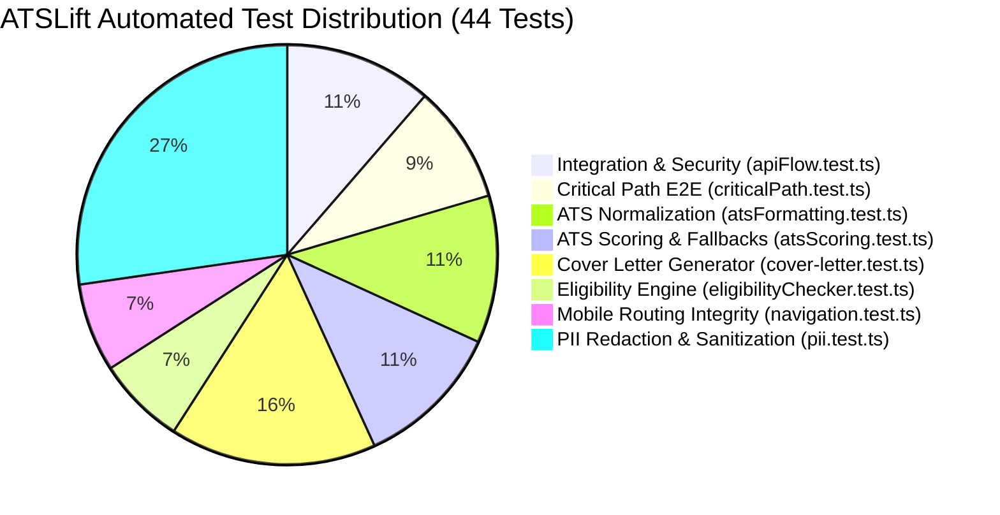

# 🧪 Testing Strategy & Quality Engineering — ATSLift

## 1. Testing Philosophy: Zero External Framework Bloat

ATSLift embraces a lean, high-velocity quality assurance philosophy: **Zero External Test Framework Bloat**. Instead of bundling heavyweight testing frameworks (such as Jest or Vitest) that introduce significant dependency overhead and slow down CI/CD pipelines, ATSLift uses **Node.js 20+ Native Test Runner** (`node:test` and `node:assert`) orchestrated via `tsx`:

```bash
npm test  # Executes tsx --test tests/**/*.test.ts in ~180ms
```

### Why Native Node.js Test Runner?
- **Speed**: Executes all 20 tests across 5 suites in **under 200ms**.
- **Zero Config**: No `jest.config.js`, `babel.config.js`, or complex transform configurations required.
- **Native TypeScript Support**: Seamless TypeScript execution powered by `tsx` (esbuild).
- **Long-Term Maintainability**: Relies on Node.js core APIs that never suffer from breaking third-party package deprecations.

---

## 2. Test Suite Breakdown (44 Tests across 12 Suites)



### Critical Path Suite: End-to-End User Workflows (`tests/integration/criticalPath.test.ts`)
| Test Name | Focus & Verification |
| :--- | :--- |
| `Density adjustment length constraints` | Validates that Normal density keeps project bullets strictly $\le$ 135 chars while Concise mode keeps $\le$ 90 chars. |
| `JD matching & missing keywords` | Simulates matching against cloud backend requirements and verifies missing keywords detection. |
| `Idempotent payment reconciliation` | Asserts that duplicate Razorpay webhooks for the same order are processed idempotently without double unlocks. |
| `End-to-end PII redaction pipeline` | Verifies full profile anonymization while preserving 100% of academic and skill signals for ATS grading. |

### Suite 1: API Flow & Webhook Security (`tests/integration/apiFlow.test.ts`)
| Test Name | Focus & Verification |
| :--- | :--- |
| `Inbound email webhook payload parser` | Validates MIME headers, extracts student alias (`jd_xxx`), and verifies company/role metadata. |
| `Webhook HMAC SHA-256 signature verification` | Generates and verifies cryptographic HMAC SHA-256 signatures; asserts that tampered payloads are rejected. |
| `ATS API output schema conforms to strict spec` | Validates that AI output strictly conforms to the expected JSON schema (`overallScore`, categories, extracted personal/skill objects). |
| `In-memory sliding window rate limiter` | Simulates burst requests; validates that the first 10 requests are allowed and the 11th is blocked with `retryAfter`. |
| `Health check endpoint schema` | Verifies that `/api/health` output includes uptime, PostgreSQL connectivity status, and service readiness flags. |

### Suite 2: ATS Normalization & Formatting (`tests/unit/atsFormatting.test.ts`)
| Test Name | Focus & Verification |
| :--- | :--- |
| `trimSkillsToLineLimit` | Verifies that skill strings exceeding line width limits are cleanly truncated with ellipsis without breaking token delimiters. |
| `normalizeTechStack` | Tests case normalization, deduplication (e.g. `React, react.js, ReactJS` ➔ `React`), and comma sanitization. |
| `formatProfileDataForPrompt` | Verifies that candidate vault profiles extract clean, markdown-formatted prompt inputs for the LLM. |
| `buildAtsScoringPrompt` | Asserts that Job Descriptions are correctly merged into the ATS prompt when provided. |
| `normalizeNormalBullet` | Validates boilerplate stripping and strict 1–1.5 line (70–125 character) bullet point enforcement for normal density. |

### Suite 3: ATS Scoring Logic & Heuristic Fallbacks (`tests/unit/atsScoring.test.ts`)
| Test Name | Focus & Verification |
| :--- | :--- |
| `DAILY_ATS_CHECK_LIMIT enforcement` | Validates that free-tier candidate accounts are capped at a maximum of 10 automated checks per day. |
| `generateHeuristicAtsFallback (minimal profile)` | Tests algorithmic keyword counting fallback when upstream LLMs time out. |
| `generateHeuristicAtsFallback (skills & links)` | Confirms point allocation for GitHub/LinkedIn links, quantified metrics, and matching skills. |
| `generateHeuristicAtsFallback (missing keywords)` | Asserts accurate detection of job description keywords absent from the candidate resume. |
| `Score clamping [35, 95]` | Guarantees scores never violate the realistic bounds (35 to 95). |

### Suite 4: Cover Letter Engine (`tests/unit/cover-letter.test.ts`)
| Test Name | Focus & Verification |
| :--- | :--- |
| `Candidate name deduplication` | Strips repeated candidate names appended via newlines or commas in sign-offs. |
| `Case-insensitive name stripping` | Ensures candidate name duplicates are caught across mixed casings and trailing spaces. |
| `Sign-off punctuation enforcement` | Validates standard comma attachment for greetings and closings. |
| `Generic placeholder removal` | Removes `[Your Name]`, `[Candidate Name]` artifacts. |
| `Null/undefined safety` | Handles empty or missing sign-off values gracefully without runtime exceptions. |

### Suite 5: PII Redaction & Data Protection (`tests/unit/pii.test.ts`)
| Test Name | Focus & Verification |
| :--- | :--- |
| `Email & Phone masking` | Masks email local-parts and phone numbers while keeping essential verification tokens. |
| `Text Stream PII Scrubber` | Redacts Aadhaar IDs, SSNs, Bearer tokens, and secrets from unstructured output. |
| `ATS Profile Anonymization` | Strips candidate identifiers before sending data to external LLMs. |
| `Deep Logger Sanitizer` | Recursively cleans password, token, and authorization fields before logging. |

### Suite 6: Campus Placement Eligibility (`tests/unit/eligibilityChecker.test.ts`)
| Test Name | Focus & Verification |
| :--- | :--- |
| `Branch matching rules` | Asserts CSE, ECE, Mech, Civil requirement matching against recruiter criterion. |
| `Strict non-rejection rules` | Validates uncertain evaluation fallbacks to avoid false negative candidate exclusions. |

### Suite 7: Mobile Navigation (`tests/unit/navigation.test.ts`)
| Test Name | Focus & Verification |
| :--- | :--- |
| `Route validity` | Validates all mobile drawer and bottom-nav routes map to active Next.js endpoints. |
| `No duplicate routes` | Guarantees uniqueness across mobile touch targets. |
----

## 3. Running the Test Suite

```bash
# 1. Run full automated unit & integration test suite
npm test

# 2. Run live concurrency & route stress tests
npm run stress:test

# 3. Simulate inbound placement email webhook delivery
npm run test:email:all
```

---

## 4. Mock Modes & Offline Testing

To enable seamless local development and automated CI evaluation without consuming paid API credits, ATSLift provides **offline mock fallbacks**:

1. **AI Generation Mock Mode**:
   - Setting `GEMINI_API_KEY="mock"` triggers the heuristic scoring synthesizer and pre-configured realistic candidate output.
2. **Razorpay Sandbox Bypass**:
   - When `RAZORPAY_KEY_ID="mock"` or testing with `?sandbox=true` in the URL, payment links trigger automatic webhook simulation to unlock resumes instantly.
3. **Transactional Email Terminal Logging**:
   - When `RESEND_API_KEY="mock"`, emails are formatted and logged to the server terminal rather than dispatched via HTTP.
