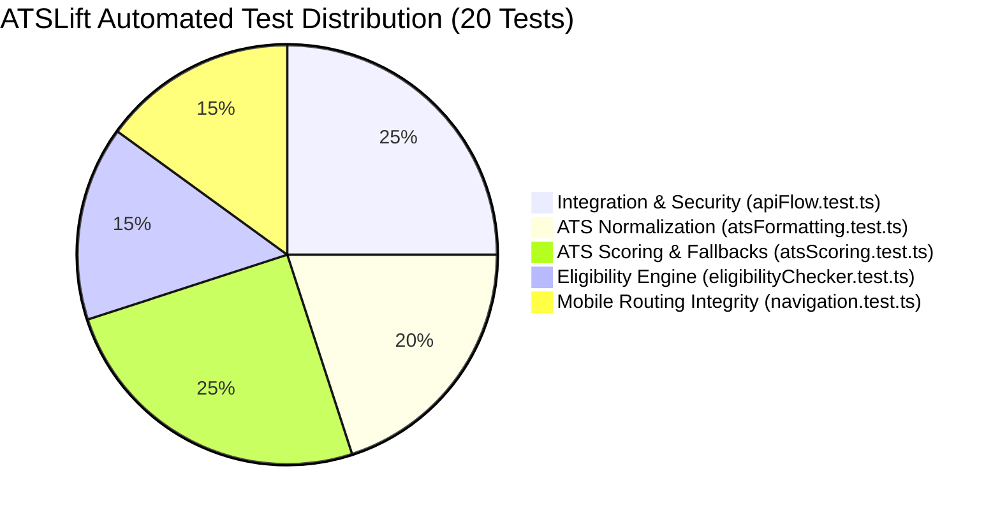

# 🧪 Testing Strategy & Quality Engineering — ATSLift

## 1. Testing Philosophy: Zero External Framework Bloat

ATSLift embraces a lean, high-velocity quality assurance philosophy: **Zero External Test Framework Bloat**. Instead of bundling heavyweight testing frameworks (such as Jest or Vitest) that introduce significant dependency overhead and slow down CI/CD pipelines, ATSLift uses **Node.js 20+ Native Test Runner** (`node:test` and `node:assert`) orchestrated via `tsx`:

```bash
npm test  # Executes tsx --test tests/**/*.test.ts in ~180ms
```

### Why Native Node.js Test Runner?
- **Speed**: Executes all 20 tests across 5 suites in **under 200ms**.
- **Zero Config**: No `jest.config.js`, `babel.config.js`, or complex transform configurations required.
- **Native TypeScript Support**: Seamless TypeScript execution powered by `tsx` (esbuild).
- **Long-Term Maintainability**: Relies on Node.js core APIs that never suffer from breaking third-party package deprecations.

---

## 2. Test Suite Breakdown (20 Tests across 5 Suites)



### Suite 1: API Flow & Webhook Security (`tests/integration/apiFlow.test.ts`)
| Test Name | Focus & Verification |
| :--- | :--- |
| `Inbound email webhook payload parser` | Validates MIME headers, extracts student alias (`jd_xxx`), and verifies company/role metadata. |
| `Webhook HMAC SHA-256 signature verification` | Generates and verifies cryptographic HMAC SHA-256 signatures; asserts that tampered payloads are rejected. |
| `ATS API output schema conforms to strict spec` | Validates that AI output strictly conforms to the expected JSON schema (`overallScore`, categories, extracted personal/skill objects). |
| `In-memory sliding window rate limiter` | Simulates burst requests; validates that the first 10 requests are allowed and the 11th is blocked with `retryAfter`. |
| `Health check endpoint schema` | Verifies that `/api/health` output includes uptime, PostgreSQL connectivity status, and service readiness flags. |

### Suite 2: ATS Normalization & Formatting (`tests/unit/atsFormatting.test.ts`)
| Test Name | Focus & Verification |
| :--- | :--- |
| `trimSkillsToLineLimit` | Verifies that skill strings exceeding line width limits are cleanly truncated with ellipsis without breaking token delimiters. |
| `normalizeTechStack` | Tests case normalization, deduplication (e.g. `React, react.js, ReactJS` ➔ `React`), and comma sanitization. |
| `formatProfileDataForPrompt` | Verifies that candidate vault profiles extract clean, markdown-formatted prompt inputs for the LLM. |
| `buildAtsScoringPrompt` | Asserts that Job Descriptions are correctly merged into the ATS prompt when provided. |

### Suite 3: ATS Scoring Logic & Heuristic Fallbacks (`tests/unit/atsScoring.test.ts`)
| Test Name | Focus & Verification |
| :--- | :--- |
| `DAILY_ATS_CHECK_LIMIT enforcement` | Validates that free-tier candidate accounts are capped at a maximum of 10 automated checks per day. |
| `generateHeuristicAtsFallback (minimal profile)` | Verifies that a sparse resume receives a baseline score (e.g. ~45–55) rather than crashing. |
| `generateHeuristicAtsFallback (points allocation)` | Tests that points are systematically awarded for GitHub links, live projects, CGPA, and metrics. |
| `Missing JD keyword identification` | Tests that missing domain keywords (e.g. `Docker, Kubernetes, AWS`) are accurately identified in gap reports. |
| `Boundary clamping [35, 95]` | Asserts that heuristic scores are strictly clamped between 35 and 95 (no unrealistic 0% or 100% scores). |

### Suite 4: Campus Placement Eligibility Engine (`tests/unit/eligibilityChecker.test.ts`)
| Test Name | Focus & Verification |
| :--- | :--- |
| `Strict non-rejection uncertain fallback rules` | Asserts that when an email is ambiguous, the system outputs `uncertain` rather than prematurely rejecting the student. |
| `BRANCH_SKILL_CONFIGS mapping` | Validates discipline-specific skill requirements across CSE, ECE, EEE, Mechanical, and Civil engineering. |
| `Personalized branch match instruction` | Verifies that multi-branch job dumps are filtered specifically to the candidate's enrolled department. |

### Suite 5: Mobile Navigation & Routing Integrity (`tests/unit/navigation.test.ts`)
| Test Name | Focus & Verification |
| :--- | :--- |
| `Valid non-empty navigation paths` | Asserts that all mobile drawer and bottom bar links target valid, non-empty paths starting with `/`. |
| `Unique route targets` | Validates that no duplicate destination paths exist across the primary navigation items. |
| `Active route matching logic` | Verifies that route prefix matching (e.g. `/myresumes/preview/123` matching `/myresumes`) highlights the correct tab. |

---

## 3. Running the Test Suite

```bash
# 1. Run full automated unit & integration test suite
npm test

# 2. Run live concurrency & route stress tests
npm run stress:test

# 3. Simulate inbound placement email webhook delivery
npm run test:email:all
```

---

## 4. Mock Modes & Offline Testing

To enable seamless local development and automated CI evaluation without consuming paid API credits, ATSLift provides **offline mock fallbacks**:

1. **AI Generation Mock Mode**:
   - Setting `GEMINI_API_KEY="mock"` triggers the heuristic scoring synthesizer and pre-configured realistic candidate output.
2. **Razorpay Sandbox Bypass**:
   - When `RAZORPAY_KEY_ID="mock"` or testing with `?sandbox=true` in the URL, payment links trigger automatic webhook simulation to unlock resumes instantly.
3. **Transactional Email Terminal Logging**:
   - When `RESEND_API_KEY="mock"`, emails are formatted and logged to the server terminal rather than dispatched via HTTP.
